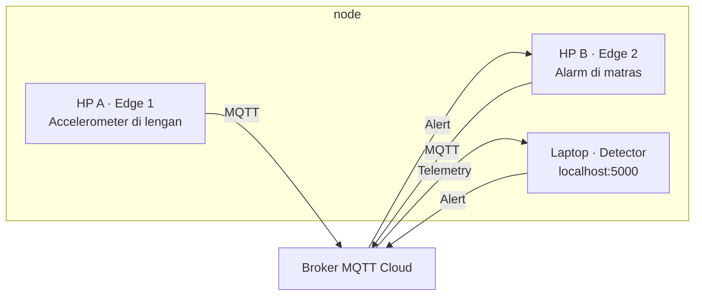

# 🏋️ SmartGym RepCounter

IoT-based Fitness Repetition and Fatigue Detector using Multi-Edge Android Sensors & Laptop Dashboard.

Contoh proyek IoT untuk belajar: **2 HP sebagai edge**, **accelerometer**, **2 proses pengolahan data** (peak detection & time-based fatigue), **MQTT Cloud**, dan **dashboard di laptop**. Data berasal dari sensor fisik - bukan simulator.


## Anggota Kelompok 09
1. Amelia Dini Hanmarizqi   (24060125140126)
2. Ummu Diana Maghfiroh     (24060125140203)
3. Firstly Gisha Janatuka   (24060125120003)

## Latar Belakang & Masalah
Saat berolahraga mandiri di rumah, sering kali kita kehilangan fokus dan lupa menghitung repetisi yang sudah dilakukan. Selain itu, kita sulit menyadari kapan otot mulai mengalami kelelahan (postur mulai berantakan). Proyek ini hadir sebagai *personal trainer* digital untuk mengatasi masalah tersebut.

## Cara kerja



HP A menghitung repetisi & mendeteksi fatigue → jika melambat >50% detector mengirim **FATIGUE** → HP B berbunyi/bergetar sebagai alarm.

## Arsitektur Sistem
1. **Edge 1 (HP di Lengan):** Membaca *Accelerometer*, menghitung repetisi (peak detection), dan mendeteksi kelelahan.
2. **Edge 2 (HP di Matras):** Menerima alarm, berbunyi/bergetar jika Edge 1 mendeteksi fatigue.
3. **Dashboard (Laptop):** Web server lokal (Flask) yang menampilkan grafik dan status secara *real-time*.

**Protokol Komunikasi:** MQTT (HiveMQ Public Broker) via Topik `smartgym_kelompok_09/...`

## Data Processing & Algoritma
Proyek ini memenuhi syarat minimal 2 jenis data processing:
1. **Peak Detection (Accelerometer):** Menghitung besaran *magnitude* (√x²+y²+z²). Gerakan naik-turun dideteksi dengan mencari lonjakan nilai yang melewati *Dynamic Threshold* (hasil kalibrasi otomatis saat HP diam).
2. **Time-Based Fatigue Detection:** Mengukur selisih waktu (*delta time*) antar repetisi. Jika jeda antar repetisi melambat lebih dari 50% dibandingkan repetisi awal, sistem menandai status **FATIGUE** dan mengirim sinyal peringatan via MQTT.

## Teknologi yang Digunakan
- **Edge Devices:** Android (Termux & Termux:API)
- **Bahasa Pemrograman:** Python 3
- **Library:** `paho-mqtt`, `flask`, `math`, `subprocess`, `json`
- **Cloud Broker:** HiveMQ (Public)
- **Dashboard:** HTML, CSS, JavaScript (Chart.js)

## 1. Laptop - jalankan detector & dashboard

Pastikan sudah ada **Python 3.10+** dan internet.

```bash
git clone https://github.com/Ummudiana/smartgym-repcounter-09.git
cd smartgym-repcounter-09
python -m pip install -r requirements.txt
```

Buat konfigurasi dari `.env.example`:

```bash
cp .env.example .env
```

*Di Windows PowerShell, gunakan `Copy-Item .env.example .env`.*

Ganti `PROJECT_ID` di `.env` menjadi nama kelompok yang unik, misalnya `smartgym_kelompok_09`. Default memakai broker publik HiveMQ (tanpa akun, **jangan kirim data rahasia**).

```bash
python dashboard.py
```

Buka browser di laptop dan akses **http://127.0.0.1:5000** (atau `http://localhost:5000`). Dashboard akan otomatis membaca konfigurasi broker publik dan PROJECT_ID.
## 2. HP 1 & HP 2 - jalankan edge device

Pada kedua HP: install **F-Droid**, lalu install **Termux** dan **Termux:API** dari F-Droid. Buka Termux, jalankan:

```bash
pkg update && pkg upgrade -y
pkg install python git termux-api -y
pip install paho-mqtt
```

Berikan izin (Permission) untuk Termux:API di pengaturan Android (Sensor & Getaran). Lalu clone repo dan samakan `PROJECT_ID` dengan laptop.

**HP 1 (Edge 1 - Lengan):**
```bash
python edge1_lengan.py
```

**HP 2 (Edge 2 - Matras):**
```bash
python edge2_matras.py
```

Jalankan di **dua HP fisik**, bukan dua terminal laptop.

## 3. Coba sistemnya

Letakkan HP 1 di lengan dan HP 2 di matras. Lakukan push-up/squat. Saat repetisi mulai melambat (fatigue), dashboard berubah status menjadi `FATIGUE` dan HP 2 berbunyi/bergetar sebagai alarm.

**Semua perangkat harus terhubung internet** (broker publik HiveMQ). Dashboard `localhost` hanya di laptop.

## Pelajari kodenya

- `dashboard.py` → Laptop (Flask + dashboard real-time)
- `edge1_lengan.py` → Edge 1 (sensor accelerometer + peak detection + fatigue detection)
- `edge2_matras.py` → Edge 2 (penerima alarm + getar/bunyi)
- `shared/processing.py` → dua data processing (peak detection & time-based fatigue)


### HP tidak terdeteksi bergerak?

- Cek indikator sensor pada dashboard (accelerometer, jumlah pesan MQTT).
- Jalankan `python edge1_lengan.py --debug-sensors` untuk mencetak data mentah.
- Alarm hanya muncul bila kedua edge + dashboard berjalan, `PROJECT_ID` MQTT sama, dan Edge 1 mendeteksi fatigue.
